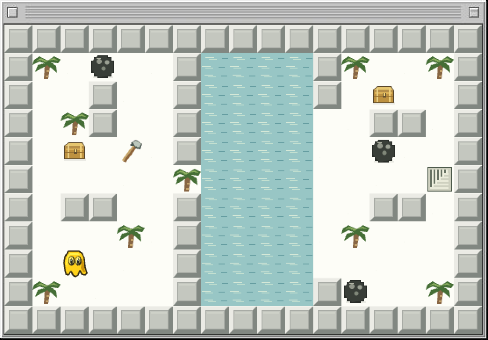

# Blobbo

**[Play Blobbo in your browser →](https://blobbo-puzzle.github.io/)**

A compact puzzle game inspired by the classic Macintosh Blobbo. Collect the chests, reach the stairs, and work out how a handful of objects can change each other's roles. The tricky part is choosing what to move—and what to leave alone.

*Try the room in the preview: download [Palm Lake](maps/palm-lake.blobbo.json) as raw JSON, then choose **Gear → Create → Import**.*

- **30 Regular and 4 Extra hard rooms.** Every room is available from the start. Pick one and explore at your own pace.
- **Unlimited undo.** Experiment freely, retrace your steps, and try another idea.
- **A quiet game window.** The puzzle takes center stage; controls are tucked into the gear menu.
- **Make your own rooms.** The built-in editor lets you create, test, save and share puzzles.

No account or installation needed. Sound effects and music have separate controls in the gear menu; music starts off.

## How to play

Collect every chest, then take the stairs. Balls, arrows, vines and movable objects obey different rules; a useful object may need to do more than one job. Open **How to play** in the gear menu for the rules and gadgets.

| Action | Control |
| --- | --- |
| Move | Arrow keys / WASD, or swipe the board |
| Wait | Space |
| Undo | Z |
| Restart | R |
| Continue after clearing a room | Enter / Return |
| Toggle full screen | L |
| Drop held tool | X, or tap **Drop** above the map on mobile |
| Rooms, editor and settings | Gear menu |

On mobile, the **Drop** button appears while you’re holding a gadget. Its arrow shows where it will land; the square ahead must be empty.

Progress and custom rooms are saved in your browser. Use the editor's **Export** button to back up rooms or share them with someone else. Saves do not sync between devices or browsers.

## Contributing

**New maps are welcome—especially Extra hard ones.** We love compact puzzles where a few pieces hide a non-obvious idea. Make the player think; keep unnecessary walking short.

Build and test a room in the editor, choose **Export**, and open a pull request with the JSON file in [`maps/`](maps/README.md). Include your suggested difficulty and a winning route inside a collapsed spoiler section in the PR description.

The [map contribution guide](maps/README.md) has the steps and an example to get started. Submissions are reviewed and checked for solvability before joining the game.

For code contributions or local setup, see the [developer guide](docs/development.md).

## Credits

Inspired by Glenn Andreas's **Blobbo** and **[Globbo by siwu](https://www.lexaloffle.com/bbs/?tid=46390)**. This is an independent recreation with its own artwork, audio and puzzles, not an official or endorsed port. See [credits](CREDITS.md) for more.

All rights reserved. See [LICENSE](LICENSE).
