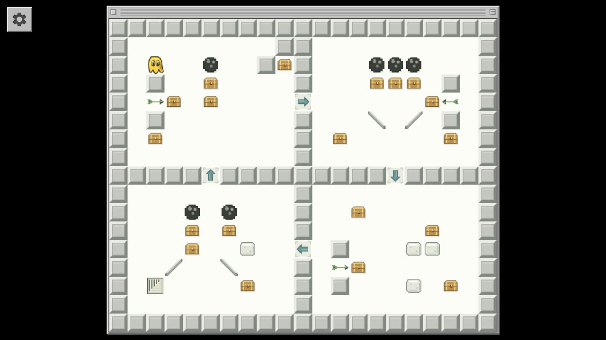

# Blobbo — The Browser Project

An independent, Macintosh-inspired puzzle game with 20 campaign rooms, 24 practice rooms, two labeled experimental rooms, an optional challenge collection, a level editor, and a seeded maze generator. New engine, artwork, sound effects, music, and level layouts. A reconstruction in progress, not an official or complete port.



## Play and develop

For the prepared download, double-click `release/Blobbo.html` to play, upload the contents of `release/upload-to-host/` for a website, or use `release/upload-to-github/` as a clean source repository. Start with `release/START-HERE.txt`. The upload folders are generated by the release command below.

No package installation is needed. Use Node.js 18+ locally (CI uses Node 24):

```sh
npm start
```

Open <http://127.0.0.1:4173>. `PORT=4174 npm start` selects another port.

```sh
npm run build
```

This creates `release/Blobbo.html`, a self-contained offline edition you can double-click, and `dist/`, the static website ready for hosting. Players need only a modern browser; Node is a development tool, not a runtime requirement.

## Controls

- Arrow keys / WASD: move. Swipe or drag the map to move one square.
- Space: wait. Z: undo. R: restart. X: drop a tool in the last movement direction.
- Gear: hover to preview the controls, click/tap to pin them open. Click outside or press Escape to dismiss. Escape also opens the menu.
- The gear contains room selection, Play/Create, undo/restart/next, audio, and editor controls. Direction buttons appear there on narrow screens.
- **Full screen** in the gear hides browser controls where the browser supports it. Press Escape or use **Exit full screen** to return. If unavailable in an embedded browser, open the game in a standalone browser and use its full-screen command.

Collect every chest, then reach the stairs. Supports, shields, tools, and return routes often need more than one job. Unlimited undo lets you explore. The playing interface has no puzzle hints or solution descriptions.

For the compact challenge set, open the gear and choose **Rooms → Extra hard challenges**. Every room has the same 15 × 13 footprint and a verified route under 110 actions. Selection uses bounded blind play attempts, not move count alone; see the [contest method and results](docs/challenge-contest.md).

Sound and music have separate switches. Music starts off; audio requires a browser gesture. Use **Play silently** or **Mute all audio** for quiet play. Progress, audio preferences, and custom rooms are stored in the current browser. Different sites and the offline edition can have separate storage.

## Create rooms

Choose **Create** inside the gear. Paint tiles, right-click to erase, and use **Test room** / **Back to editor** to playtest. **Save** keeps a room in this browser. **Export** downloads a portable `.blobbo.json` file; **Import** loads one. Keep exported backups if browser storage is cleared.

The seeded generator makes connected, solvable mazes with recorded solutions. It does not generate arbitrary gadget puzzles. Editing a generated room invalidates its saved solution; custom rooms need playtesting.

```json
{"format":"blobbo-browser","version":1,"level":{"name":"My room","rows":["#######","#@.$.E#","#######"]}}
```

The tile legend is `TILE_INFO` in `src/engine.js`. Built-in rooms live in `src/levels.js` and `src/challenges.js`; stable campaign order is in `src/campaign.js`.

## Verify and package

```sh
npm test
npm run audit:levels
npm run release
```

`npm run release` runs the tests and full audit, then packages everything. It requires the standard `zip` command (included on macOS and GitHub's Ubuntu runners). There are no npm dependencies and no credentials or network calls in the build.

| Output | Use |
| --- | --- |
| `release/Blobbo.html` | Single-file offline game |
| `release/upload-to-host/` | Ready to upload; self-contained `index.html`, credits, license |
| `release/upload-to-github/` | Clean source repository, including hidden workflow files |
| `release/START-HERE.txt` | Upload instructions; no build required for the game-only folder |
| `release/blobbo-web.zip` | Upload to a static host; `index.html` at ZIP root |
| `release/blobbo-source.zip` | Self-contained repository source, including hidden workflow files |
| `release/SHA256SUMS` | Checksums for the three downloads |
| `reports/level-audit.json` | Winning witnesses and audit metrics |

All built-in maps and 1,000 generator seeds have verified legal winning routes. The campaign progresses through four bands, ending with longer plans and more shared-object dependencies. See the [audit and its limits](docs/level-audit.md). Separate [campaign solutions](docs/solutions.md) and [challenge solutions](docs/challenge-solutions.md) contain spoilers and are excluded from hosting. Challenge keys also stay out of the standalone HTML. Witness lengths are not guaranteed shortest paths, and human playtesting remains necessary to judge difficulty.

## Repository layout

```text
src/        Browser game source; editable HTML/CSS/JS/SVG
scripts/    Local server, build, puzzle audit, release packaging
tests/     Rules, maps, motion, audio, migration, and bundle tests
docs/      Hosting, audit, developer solutions, research, screenshot
.github/    Verification and GitHub Pages deployment
dist/      Generated static website (ignored)
release/   Generated downloads (ignored)
reports/   Generated machine-readable audit (ignored)
```

Generated directories can be rebuilt. Local research screenshots, earlier builds, and browser saves are excluded from the upload folders and source ZIP.

## Publish

For the quickest GitHub Pages setup, upload the contents of `release/upload-to-host/` to a new repository's root. Choose **Settings → Pages → Deploy from a branch → main → / (root)** and save. For a repository with editable source and automatic verification, use `release/upload-to-github/`, choose **Settings → Pages → GitHub Actions**, and run **Verify and deploy**. See the [step-by-step hosting guide](docs/hosting.md). There is no backend to operate.

No remote repository or public deployment has been created yet. Rights remain reserved under [LICENSE](LICENSE); a public-release license will be chosen separately.

## Fidelity and credits

Inspired by Glenn Andreas's Blobbo and informed by siwu's Globbo. [Credits and provenance](CREDITS.md) document what is newly made. [Research notes](docs/research.md) separate observed rules from reconstruction choices.

Implemented mechanics include chests/stairs, adjacent-hazard stability, bowling balls, arrows, diagonal ramps, marshmallows, spikes, one-way floors, plants/shears, single-tool carrying and dropping, corks/holes, fire/extinguishers, axes/trees, and canoes. Exact original update timing, vine growth, and canoe behavior still need comparison; water has no current. The two prototype water experiments are separate from the campaign. Advanced original gadgets and creatures remain unimplemented.

Movement uses separately drawn compression, spread, reach, and gathering poses with a classic/reduced option. Effects are newly synthesized and the optional music is a new composition. No original samples, artwork, or levels are bundled.

Real-browser checks cover core play, editor controls, audio activation, and desktop/narrow layouts. This release also checks the packaged website under a project subdirectory and executes the standalone bundle over localhost. See [release verification](docs/verification.md). Direct `file:` playback and physical-phone gestures still need manual device checks.
